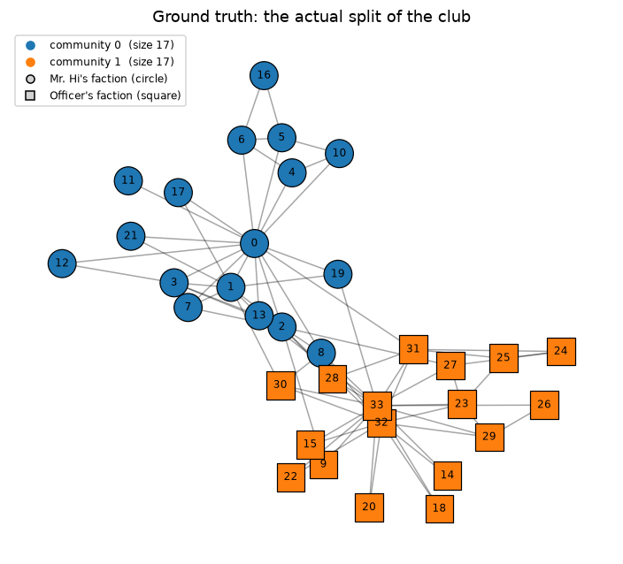
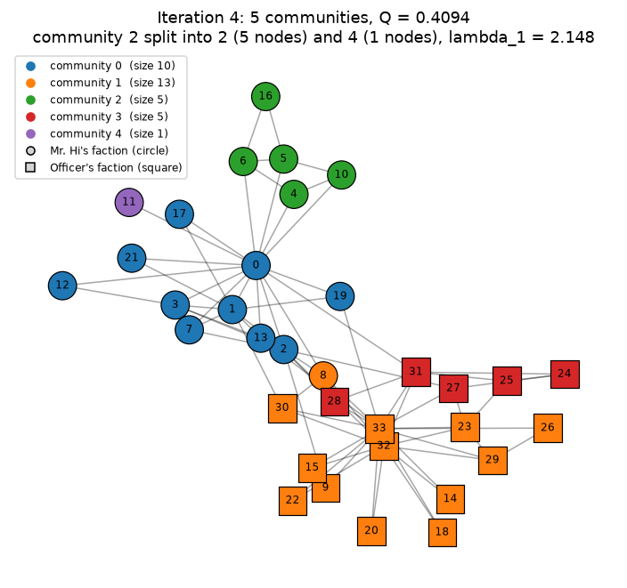

# Modularity on the Karate Club Graph

**DSC212 – Graph Theory Module · Research Assignment**

Spectral modularity community detection implemented from scratch (NumPy + NetworkX) on Zachary's Karate Club network, extended to multiple communities by recursive bisection, with node-level metrics tracked after every split.

**Main file:** [`karate_club_modularity.ipynb`](karate_club_modularity.ipynb) (runs top-to-bottom without edits; outputs are already saved in the notebook).

## What the notebook does
1. Builds the modularity matrix `B = A - k kᵀ / 2m` and checks its properties (symmetry, `B·1 = 0`, `Q = 0` for the trivial partition).
2. Splits a community with the sign of the leading eigenvector of the restricted matrix `B^(C)`, and stops when `λ₁ ≤ 0`.
3. Applies this recursively (recursive bisection) to find multiple communities.
4. Draws the graph after every split (fixed layout, one colour per community, node IDs as labels).
5. After every split computes degree, betweenness, closeness and clustering with NetworkX (inside each node's current community) and plots how each node's value evolves.
6. Discusses which nodes remain central and how community structure influences the metrics.

## Results
| | |
|---|---|
| Splits performed | 4 → 5 communities |
| Final modularity Q | 0.4094 (matches `networkx` modularity) |
| First split vs. real split | 33 of 34 members on the correct side (only node 8 differs) |
| Most consistently central nodes | 0 (Mr. Hi), 33 (president), and 32 |

| Ground truth | Final partition (iteration 4) |
|---|---|
|  |  |

Metric evolution plots: [`degree`](assets/metric_degree.png) · [`betweenness`](assets/metric_betweenness.png) · [`closeness`](assets/metric_closeness.png) · [`clustering`](assets/metric_clustering.png)

## Repository structure
```
├── karate_club_modularity.ipynb   # the notebook (submission)
├── requirements.txt
├── README.md
└── assets/                        # figures produced by the notebook
```

## How to run
```bash
pip install -r requirements.txt
jupyter notebook karate_club_modularity.ipynb    # then: Kernel -> Restart & Run All
```

## References
- M. E. J. Newman (2006), *Modularity and community structure in networks*, PNAS 103(23):8577–8582.
- W. W. Zachary (1977), *An information flow model for conflict and fission in small groups*, Journal of Anthropological Research 33(4):452–473.
